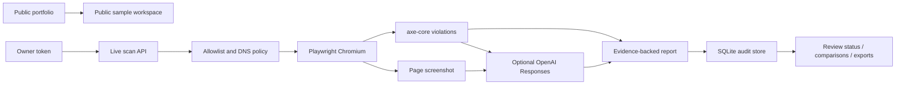

# AccessBloom architecture

## Folder boundaries
- `public/`: responsive, accessible-first client; no secrets
- `server/index.js`: authenticated API and static delivery
- `server/security.js`: URL and target restrictions
- `server/audit.js`: isolated browser-based checks
- `server/ai.js`: optional evidence-grounded multimodal enrichment
- `server/report.js`: stable issue IDs and comparison
- `server/store.js`: SQLite persistence and reviewer notes
- `server/demo.js`: synthetic sample evidence; never saved as real scanning
- `portfolio-integration/portfolio-case/`: standalone public portfolio case page
- `scripts/`: safe installation and opt-in publishing helpers

## Application routes
- `/accessbloom/` public demo workspace
- `/accessbloom/api/health` public status
- `/accessbloom/api/config` public feature flags only
- `/accessbloom/api/demo` clearly marked sample report
- `/accessbloom/api/scans` owner POST scan
- `/accessbloom/api/reports` owner GET history
- `/accessbloom/api/reports/:id` owner GET/DELETE
- `/accessbloom/api/reports/:id/issues/:issueId` owner PATCH human review
- `/accessbloom/api/reports/:id/screenshot` owner image
- `/accessbloom/api/reports/:id/export/:format` owner structured export

## Privacy and trust
Public visitors do not receive owner reports. API tokens are entered by an operator and kept only in the tab's in-memory state. AI output is explicitly labeled as generated, and failure falls back to raw axe evidence. Manual review and assisted-technology testing remain necessary.
